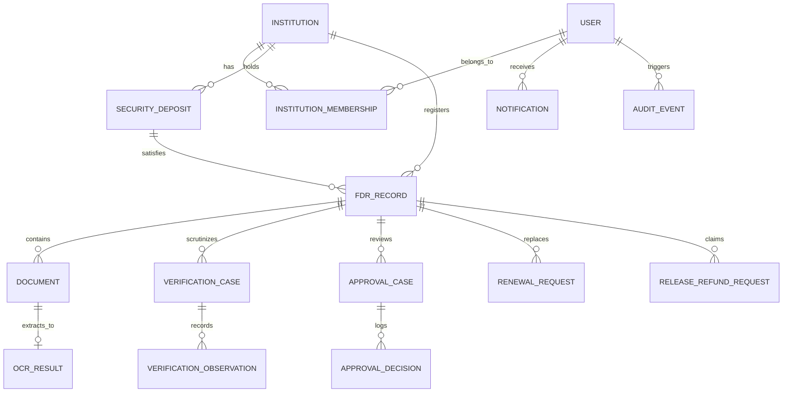

# Database Architecture & Entity Relationship Documentation

## Database Technology
- **Production Engine**: PostgreSQL 16+
- **Local Dev / Standalone Engine**: SQLite / PostgreSQL (Prisma ORM Multi-provider)
- **ORM**: Prisma Client v5.22.0

---

## Entity Relationship Overview

---

## Core Models

### 1. `User`
Stores system administrators, verification officers, approving authorities, auditors, and institution officers.
- `id` (UUID Primary Key)
- `email` (Unique VARCHAR)
- `passwordHash` (Argon2id / bcrypt salted hash)
- `fullName` (VARCHAR)
- `role` (ENUM: `SUPER_ADMIN`, `INSTITUTION_ADMIN`, `INSTITUTION_STAFF`, `VERIFICATION_OFFICER`, `APPROVING_AUTHORITY`, `AUDITOR`)
- `phone` (VARCHAR, optional)
- `isActive` (BOOLEAN, default true)
- `lastLoginAt` (TIMESTAMPTZ)
- `createdAt`, `updatedAt` (TIMESTAMPTZ)

### 2. `Institution`
Stores approved colleges, universities, and polytechnic institutes.
- `id` (UUID Primary Key)
- `officialIdentifier` (Unique VARCHAR, e.g. `AICTE-1-4928172`)
- `name` (VARCHAR)
- `address`, `state`, `district`, `pinCode` (TEXT)
- `contactEmail`, `contactPhone` (VARCHAR)
- `approvalReference` (VARCHAR, e.g. EOA Letter number)
- `accountStatus` (ENUM: `PENDING_APPROVAL`, `ACTIVE`, `SUSPENDED`, `REJECTED`)
- `registrationDate` (TIMESTAMPTZ)

### 3. `SecurityDeposit`
Represents the underlying institutional statutory obligation under the AICTE Approval Process Handbook (APH).
- `id` (UUID Primary Key)
- `institutionId` (UUID Foreign Key -> Institution)
- `depositReference` (Unique VARCHAR)
- `programCategory` (VARCHAR, e.g. "Engineering & Technology", "Management")
- `requiredAmount` (DECIMAL 14,2)
- `currency` (VARCHAR default "INR")
- `status` (VARCHAR: `ACTIVE`, `RELEASED`, `FORFEITED`, `DEFICIENT`)

### 4. `FDRRecord`
The specific financial Fixed Deposit Receipt certificate securing the deposit.
- `id` (UUID Primary Key)
- `institutionId` (UUID Foreign Key -> Institution)
- `securityDepositId` (UUID Foreign Key -> SecurityDeposit)
- `fdrNumber` (VARCHAR, Indexed)
- `issuingBank` (VARCHAR)
- `bankBranch` (VARCHAR)
- `ifscCode` (VARCHAR)
- `depositAmount` (DECIMAL 14,2)
- `issueDate` (DATE)
- `maturityDate` (DATE, Indexed)
- `jointName` (VARCHAR: Mandated joint holding designation)
- `accountStatus` (ENUM: `DRAFT`, `SUBMITTED`, `UNDER_REVIEW`, `VERIFIED`, `DISCREPANT`, `APPROVED`, `REJECTED`, `RETURNED_FOR_CORRECTION`, `MATURED`, `RENEWED`, `RELEASED`)
- `verificationStatus` (ENUM: `NOT_SUBMITTED`, `PENDING_VERIFICATION`, `UNDER_REVIEW`, `ADDITIONAL_INFO_REQUIRED`, `DISCREPANCY_FOUND`, `VERIFICATION_RECORDED`, `VERIFICATION_FAILED`, `READY_FOR_APPROVAL`)
- `autoRenewal` (BOOLEAN default false)
- `isPotentialDuplicate` (BOOLEAN default false: Flags duplicates without silent merge/deletion)
- `duplicateNotes` (TEXT)

### 5. `Document`
Stores private metadata for uploaded supporting files (scanned receipts, bank confirmation letters).
- `id` (UUID Primary Key)
- `institutionId` (UUID Foreign Key -> Institution)
- `fdrId` (UUID Foreign Key -> FDRRecord)
- `documentType` (VARCHAR)
- `originalFilename` (VARCHAR)
- `storagePath` (VARCHAR: Server-generated UUID filename preventing path traversal)
- `mimeType` (VARCHAR: Enforces PDF, PNG, JPEG)
- `fileSize` (INTEGER: Enforces 10MB limit)
- `checksumSha256` (VARCHAR(64): Tamper verification)

### 6. `OCRResult`
Stores optical character extraction comparison data.
- `id` (UUID Primary Key)
- `documentId` (Unique UUID Foreign Key -> Document)
- `extractedFdrNumber`, `extractedBankName`, `extractedAmount`, `extractedMaturityDate`
- `status` (`PENDING`, `PROCESSING`, `COMPLETED`, `FAILED`, `NEEDS_MANUAL_REVIEW`)
- `mismatchFlags` (JSON)
- `reviewerConfirmed` (BOOLEAN)

### 7. `VerificationCase` & `VerificationObservation`
Dedicated officer scrutiny workbench records.
- Records data mismatch, illegible scans, amount mismatches, and bank confirmation letters.
- Tracks external verification reference without fabricated bank APIs.

### 8. `ApprovalCase` & `ApprovalDecision`
Multi-stage financial and administrative sanction log.
- Decision types: `APPROVED`, `REJECTED`, `RETURNED_FOR_CORRECTION`.
- Enforces strict role authority.

### 9. `RenewalRequest`
Maintains immutable audit links between old expiring instruments and new replacement deposits.

### 10. `ReleaseRefundRequest`
Formal refund/release claims verifying:
- AICTE NOC Certificate.
- Zero pending regulatory inquiries.
- DTE concurrence.
- Accurate external UTR settlement reference tracking.

### 11. `AuditEvent` (Append-Only)
Immutable security ledger logging Actor, Role, Action, Resource, Diff payload, IP, and Request Correlation ID.
